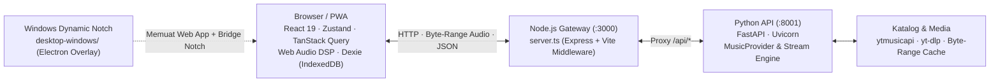

<div align="center">

<br />


<br /><br />


<br />

[](https://react.dev/)
[](https://www.typescriptlang.org/)
[](https://vite.dev/)
[](https://tailwindcss.com/)
[](https://fastapi.tiangolo.com/)
[](https://web.dev/progressive-web-apps/)
[](desktop-windows/README.md)

<p>
  <a href="#kapabilitas-inti">Kapabilitas</a> &nbsp;·&nbsp;
  <a href="#arsitektur-sistem">Arsitektur</a> &nbsp;·&nbsp;
  <a href="#mulai-cepat">Mulai Cepat</a> &nbsp;·&nbsp;
  <a href="#referensi-teknis">Referensi Teknis</a> &nbsp;·&nbsp;
  <a href="#windows-dynamic-notch">Desktop Notch</a>
</p>

</div>


## Kapabilitas Inti

**SoundClear** dirancang dengan pendekatan pemrosesan audio tingkat studio langsung di browser—menggabungkan mesin Web Audio API DSP real-time, katalog streaming adaptif, pustaka offline berbasis IndexedDB, lirik karaoke tersinkronisasi, dan antarmuka kaca gelap yang mengikuti palet warna sampul album.

<table>
  <tr>
    <td width="50%" valign="top">
      <h3>Web Audio DSP Engine</h3>
      <p>Rantai pemrosesan sinyal real-time tanpa latensi berlebih langsung di browser.</p>
      <ul>
        <li><strong>Equalizer 10-Band</strong> berbasis <code>BiquadFilterNode</code> dengan kurva respon SVG live serta preset bawaan &amp; kustom.</li>
        <li><strong>Bass Boost &amp; Stereo Widener</strong> dengan kontrol intensitas presisi <code>0–100%</code>.</li>
        <li><strong>Normalisasi LUFS &amp; ReplayGain</strong> (<code>Quiet</code>, <code>Normal</code>, <code>Loud</code>) plus <em>Dynamics Limiter</em> anti-kliping.</li>
        <li><strong>Transisi Equal-Power Crossfade</strong> (<code>0–12 detik</code>), <em>Gapless Playback</em>, <em>Direct Mode</em>, <em>Spectrum Analyzer</em> FFT, dan pemilihan perangkat output audio.</li>
      </ul>
    </td>
    <td width="50%" valign="top">
      <h3>Katalog, Streaming &amp; Offline</h3>
      <p>Akses musik online dan koleksi pribadi dalam satu antarmuka terpadu.</p>
      <ul>
        <li><strong>Katalog Lengkap</strong>: Beranda rekomendasi, Tangga Lagu Indonesia, Mood &amp; Genre, Pencarian multi-filter, Artis, Album, Playlist, serta Podcast.</li>
        <li><strong>Streaming Byte-Range</strong> lewat <code>/api/stream/{video_id}</code> dengan penyesuaian kualitas otomatis &amp; fallback ke pemutar YouTube.</li>
        <li><strong>Impor Audio Lokal</strong> (<code>MP3</code>, <code>FLAC</code>, <code>WAV</code>, <code>OGG</code>) dengan ekstraksi tag &amp; sampul via <code>music-metadata-browser</code>.</li>
        <li><strong>Penyimpanan Offline</strong> persisten di <strong>IndexedDB (Dexie)</strong> &amp; <strong>Cache Storage</strong> beserta halaman analitik <strong>Rekap</strong>.</li>
      </ul>
    </td>
  </tr>
  <tr>
    <td width="50%" valign="top">
      <h3>Visual Adaptif &amp; Lirik Karaoke</h3>
      <p>Permukaan gelap bertingkat yang bereaksi terhadap musik yang sedang diputar.</p>
      <ul>
        <li><strong>Dynamic Ambient Theme</strong> mengekstrak warna dominan sampul album melalui <code>/api/artwork-color</code>.</li>
        <li><strong>Kustomisasi Latar</strong> mendukung mode <em>Ambient</em>, <em>Preset</em>, <em>Warna Solid</em>, <em>Gradien</em>, hingga unggah gambar kustom dengan kontrol blur &amp; <em>panel glass</em>.</li>
        <li><strong>Lirik Tersinkronisasi</strong> per baris di panel kanan maupun mode layar penuh (<em>Karaoke View</em>).</li>
        <li><strong>Shell Mobile &amp; PWA</strong> siap dipasang sebagai aplikasi mandiri di desktop maupun seluler.</li>
      </ul>
    </td>
    <td width="50%" valign="top">
      <h3>Windows Dynamic Notch</h3>
      <p>Pemutar mini melayang di atas layar dengan lirik berjalan secara real-time.</p>
      <ul>
        <li><strong>In-Web &amp; External PiP</strong> untuk kontrol cepat dan tampilan lirik live tanpa meninggalkan aplikasi lain.</li>
        <li><strong>Pembungkus Electron Khusus Windows</strong> pada direktori <code>desktop-windows/</code>.</li>
        <li><strong>Frameless &amp; Click-Through</strong> dengan penempatan otomatis di tengah atas monitor utama, monitor aktif, atau layar eksternal pilihan.</li>
      </ul>
    </td>
  </tr>
</table>

<br />


## Arsitektur Sistem



<details>
<summary><strong>Struktur Direktori Proyek</strong></summary>

<br />

```text
SoundClearr/
├── server.ts                  # Gateway Express + Vite middleware + auto-bootstrap venv Python
├── package.json               # Skrip & dependensi Node.js / Frontend
├── vite.config.ts             # Konfigurasi Vite, Tailwind CSS v4, & VitePWA
├── tsconfig.json              # Konfigurasi TypeScript
├── docs/                      # Aset grafis & diagram animasi SVG untuk dokumentasi
├── src/                       # Entry point Vite (/src/main.tsx)
├── frontend/src/
│   ├── api/                   # Klien HTTP (/api/*) + unit test
│   ├── audio/                 # Mesin Web Audio API DSP (soundclearAudioEngine.ts)
│   ├── components/            # PlayerBar, Sidebar, RightPanel, Footer, Notch, Fullscreen
│   ├── db/                    # Skema IndexedDB (Dexie) untuk pustaka & audio lokal
│   ├── pages/                 # Beranda, Cari, Moods, Detail, Koleksi, Rekap, Pengaturan
│   ├── store/                 # State management Zustand (player, library, settings, navigation)
│   ├── types/                 # Definisi tipe TypeScript
│   └── utils/                 # Logika murni (audioMath, playerLogic, recapLogic, notch) + test
├── backend/
│   ├── main.py                # Layanan FastAPI & seluruh endpoint /api/*
│   ├── music_provider.py      # Mesin katalog, lirik, ekstraksi warna sampul, & streaming
│   ├── requirements.txt       # Dependensi Python (FastAPI, Uvicorn, ytmusicapi, yt-dlp, Pillow)
│   └── test_music_provider.py # Unit test backend Python
├── api/index.py               # Entry point serverless
└── desktop-windows/           # Aplikasi Electron Dynamic Notch khusus Windows 10/11
```

</details>


## Mulai Cepat

### Prasyarat
- **Node.js 22+** & **npm**
- **Python 3.10+** *(lingkungan `backend/.venv` otomatis dibuat oleh `server.ts` saat dijalankan)*
- **FFmpeg** *(disarankan untuk pemrosesan aliran audio)*

### Instalasi & Menjalankan Aplikasi

```bash
# 1. Pasang dependensi Node.js
npm install

# 2. (Opsional) Salin template konfigurasi environment
cp .env.example .env

# 3. Jalankan mode pengembangan pada http://localhost:3000
npm run dev
```

### Build Produksi & Pengujian

```bash
# Build bundle produksi Vite ke dist/
npm run build

# Jalankan server produksi
npm start

# Pemeriksaan tipe TypeScript
npm run lint

# Unit test frontend
npx tsx --test \
  frontend/src/api/client.test.ts \
  frontend/src/utils/audioMath.test.ts \
  frontend/src/utils/backgroundTheme.test.ts \
  frontend/src/utils/notchPlayer.test.ts \
  frontend/src/utils/playerLogic.test.ts \
  frontend/src/utils/recapLogic.test.ts \
  frontend/src/utils/streamPlaybackLogic.test.ts

# Unit test backend Python
backend/.venv/bin/python -m unittest discover -s backend -p "test_*.py"
```


## Referensi Teknis

<details>
<summary><strong>Variabel Lingkungan (.env.example)</strong></summary>

<br />

| Variabel | Deskripsi | Default |
| :--- | :--- | :--- |
| `APP_PORT` | Port server utama Express + Vite | `3000` |
| `PYTHON_PORT` | Port internal layanan FastAPI Python | `8001` |
| `CACHE_TTL_SECONDS` | Durasi cache metadata katalog musik | Default provider |
| `DISABLE_HMR` | Nonaktifkan Vite HMR (`true` untuk lingkungan tertentu) | `false` |
| `SOUNDCLEAR_AUDIO_SETTINGS_FILE` | Lokasi berkas penyimpanan profil audio server | Lokal backend |
| `SOUNDCLEAR_DISABLE_WARMUP` | Set `1` untuk menonaktifkan *warmup* katalog saat startup | `0` |
| `SOUNDCLEAR_PURE_PYTHON_STREAM` | Gunakan mode streaming murni Python | `0` |
| `SOUNDCLEAR_STREAM_CACHE_DIR` | Direktori cache sementara aliran audio | `/tmp/soundclear_stream_cache` |
| `YTMUSIC_COOKIES` | String cookie sesi YouTube Music (opsional) | — |
| `YTMUSIC_COOKIES_FILE` | Path ke berkas cookie YouTube Music (opsional) | — |

</details>

<details>
<summary><strong>Pintasan Keyboard</strong></summary>

<br />

| Tombol | Aksi |
| :--- | :--- |
| `Spasi` | Putar atau jeda lagu aktif |
| `Panah Kanan` / `Panah Kiri` | Maju atau mundur 5 detik |
| `Shift + Panah Kanan` / `Kiri` | Lagu berikutnya / sebelumnya |
| `M` | Bisukan atau nyalakan kembali suara |
| `L` | Buka tab lirik / mode karaoke layar penuh |
| `S` | Aktifkan atau matikan *Shuffle* |
| `R` | Ubah mode ulang (`Mati` / `Semua` / `Satu Lagu`) |
| `?` | Buka halaman daftar pintasan keyboard |
| `Esc` | Tutup dialog, menu konteks, atau tampilan layar penuh |

</details>

<details>
<summary><strong>Ringkasan Endpoint API Backend</strong></summary>

<br />

Seluruh endpoint tersedia di bawah prefix `/api` dan otomatis diproksikan oleh `server.ts`:

| Kategori | Endpoint | Keterangan |
| :--- | :--- | :--- |
| **Status** | `GET /api/health` | Status kesehatan layanan & provider |
| **Katalog** | `GET /api/home`, `/api/charts`, `/api/moods`, `/api/moods/{params}` | Beranda, tangga lagu, mood & genre |
| **Pencarian** | `GET /api/search`, `GET /api/suggest` | Pencarian multi-filter & saran kueri |
| **Detail** | `GET /api/artist/{id}`, `/api/album/{id}`, `/api/playlist/{id}`, `/api/podcast/{id}`, `/api/episode/{id}` | Metadata lengkap & daftar trek/episode |
| **Pemutaran** | `GET /api/watch/{video_id}`, `/api/play/resolve`, `/api/stream/{video_id}/meta`, `GET/HEAD /api/stream/{video_id}` | Antrean radio, resolusi ID, & streaming byte-range |
| **Lirik & Visual** | `GET /api/lyrics`, `/api/song/{id}/credits`, `/api/song/{id}/related`, `/api/artwork-color` | Lirik tersinkron, kredit lagu, & warna dominan sampul |
| **Pengaturan** | `GET/PUT /api/account/audio-settings`, `POST /api/account/audio-settings/reset` | Sinkronisasi profil DSP |

</details>


## Windows Dynamic Notch

Untuk menjalankan pemutar mini notch melayang di luar jendela browser pada **Windows 10 / 11**:

```bash
cd desktop-windows
npm install
set SOUNDCLEAR_URL=http://localhost:3000
npm start
```

Untuk mengemas installer Windows (`.exe`):

```bash
npm run build:win
```

<br />

<div align="center">


<br />

**© 2026 zhafx.corp** — SoundClear

</div>
