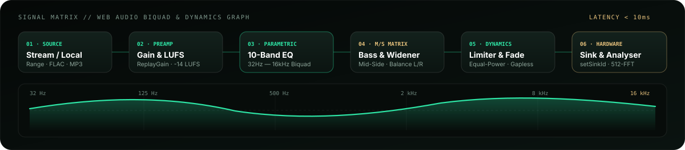
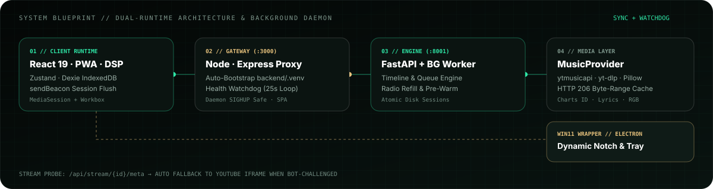

<div align="center">

<br />


<br /><br />

<picture>
  
</picture>

<br />

<picture>
  
</picture>

<br />

<sub>
  <a href="#disiplin-rekayasa">Rekayasa Audio</a> &nbsp;&nbsp;·&nbsp;&nbsp;
  <a href="#matriks-sinyal-dsp">Matriks DSP</a> &nbsp;&nbsp;·&nbsp;&nbsp;
  <a href="#windows-dynamic-notch">Dynamic Notch</a> &nbsp;&nbsp;·&nbsp;&nbsp;
  <a href="#cetak-biru-sistem">Cetak Biru Sistem</a> &nbsp;&nbsp;·&nbsp;&nbsp;
  <a href="#operasional-lokal">Operasional Lokal</a> &nbsp;&nbsp;·&nbsp;&nbsp;
  <a href="#indeks-teknis">Indeks Teknis</a>
</sub>

</div>

<br />


> **Dirancang seperti perangkat keras mastering di atas peramban.**
> SoundClear menyatukan rantai **Web Audio API DSP 32-bit float**, katalog streaming berorientasi **Tangga Lagu Indonesia**, gudang **IndexedDB offline** berkecepatan tinggi, pemutar melayang **Windows Dynamic Notch**, serta **background worker 24/7** dalam satu arsitektur terpadu.

<br />

## Disiplin Rekayasa

| Sub-Sistem | Kapabilitas Inti | Implementasi Nyata |
| :--- | :--- | :--- |
| **`01` · Web Audio DSP** | Equalizer parametrik 10-band, Preamp, Bass Boost, Stereo Widener M/S, Normalisasi LUFS, dan Anti-Clipping Limiter. | `BiquadFilterNode`, `DynamicsCompressorNode`, kurva respon SVG real-time, *Equal-Power Crossfade* `0–12 dtk`, *Gapless*, *Direct Mode*, dan `setSinkId()`. |
| **`02` · Katalog & Streaming** | Kurasi **Tangga Lagu Indonesia** lintas genre, Pencarian multi-filter, Artis, Album, Podcast, hingga *Radio Watch*. | Probing `/api/stream/{id}/meta` + dukungan *Byte-Range* (`HTTP 206`) dengan pengalihan otomatis mulus ke pemutar YouTube IFrame saat terjadi *bot-check*. |
| **`03` · Daemon Latar Belakang** | Pemeliharaan sesi putar & *pre-warming* yang terus hidup meskipun peramban ditutup. | Worker FastAPI persisten memajukan *timeline* putar, mengisi ulang antrean radio, menyinkronkan status via `navigator.sendBeacon`, plus skrip daemon `start:bg`. |
| **`04` · Brankas Audio Offline** | Impor berkas audio lokal dan simpan lagu favorit untuk pemutaran tanpa jaringan. | Dukungan `MP3`, `FLAC`, `WAV`, `OGG` dengan ekstraksi tag ID3/sampul, penyimpanan persisten di **IndexedDB (Dexie)**, serta Caching Service Worker PWA. |
| **`05` · Permukaan Kaca Adaptif** | Tema ambient dinamis dari palet warna sampul album serta tampilan lirik karaoke tersinkronisasi. | Ekstraktor warna RGB backend (`/api/artwork-color`), mode latar kustom, animasi baris lirik presisi milidetik, dan analitik **Rekap**. |

<br />

<a id="matriks-sinyal-dsp"></a>

## Matriks Sinyal DSP

Rantai pemrosesan audio disusun berurutan dengan jalur *bypass* instan (**Direct Mode**) ketika reproduksi bit-transparan diinginkan:

<br />

<picture>
  
</picture>

<br />

```text
  [ Audio Source ] ──▶ [ Preamp & LUFS (-14) ] ──▶ [ 10-Band Biquad EQ ] ──▶ [ M/S Stereo Widener ] ──▶ [ Limiter (-1dBFS) ] ──▶ [ Sink / FFT ]
         │                                                                                                                               ▲
         └─────────────────────────────── Direct Mode (Zero-DSP Hardware Bypass Path) ───────────────────────────────────────────────────┘
```

<br />

<a id="windows-dynamic-notch"></a>

## Windows Dynamic Notch & System Tray

Pengalaman desktop khusus Windows 10/11 melalui pembungkus **Electron** di `desktop-windows/` — menghadirkan kapsul *Always-on-Top* tanpa bingkai di puncak monitor lengkap dengan lirik berjalan, kontrol pemutaran IPC, dan ketahanan latar belakang berbasis *System Tray*.

<br />

<picture>
  
</picture>

<br />

```powershell
# Menjalankan host Dynamic Notch di Windows 10 / 11
cd desktop-windows
npm install
set SOUNDCLEAR_URL=http://localhost:3000
npm start

# Mengemas installer .exe mandiri
npm run build:win
```

<br />


<a id="cetak-biru-sistem"></a>

## Cetak Biru Sistem

Gateway Node.js pada port `3000` bertindak sebagai orkestrator tunggal: menyajikan SPA Vite/React, memproksikan seluruh lalu lintas `/api/*`, mengawasi kesehatan proses FastAPI Python setiap 25 detik (*watchdog*), serta mengisolasi dependensi Python secara otomatis di `backend/.venv`.

<br />

<picture>
  
</picture>

<br />

<details>
<summary><strong>Peta Direktori Sumber (Monorepo Modular)</strong></summary>

<br />

```text
SoundClear/
├── server.ts                  # Express Gateway (:3000) · Proxy /api · Watchdog Python · Daemon SIGHUP handler
├── package.json               # Skrip kontrol dev, produksi, dan daemon latar belakang (start:bg / stop:bg)
├── vite.config.ts             # Vite 8 · Tailwind CSS v4 · Workbox PWA (NetworkFirst catalog cache)
├── scripts/
│   └── background-server.sh   # Runner daemon latar belakang Linux/macOS (PID & log terkelola)
├── docs/                      # Modul visual vektor & diagram animasi SMIL untuk dokumentasi
├── frontend/src/
│   ├── api/                   # Klien HTTP (/api/*), Range reassembly, & sendBeacon session sync
│   ├── audio/                 # SoundClearAudioEngine (Web Audio DSP graph, FFT, LUFS, auto-resume)
│   ├── components/            # PlayerBar, Sidebar, RightPanel, LocalAudioEngine, YouTubePlayerBridge, Notch
│   ├── db/                    # Skema IndexedDB (Dexie) untuk berkas lokal, unduhan offline, & sesi
│   ├── pages/                 # HomePage, SearchPage, MoodsPage, DetailPages, LibraryPages, Recap, Settings
│   ├── store/                 # State management Zustand (player, library, settings, navigation)
│   └── utils/                 # Logika murni teruji unit (audioMath, playerLogic, recapLogic, notchPlayer)
├── backend/
│   ├── main.py                # Layanan FastAPI, siklus hidup lifespan, & seluruh endpoint /api/*
│   ├── background_worker.py   # Worker 24/7: persistensi sesi disk, transisi antrean, & pre-warm cache
│   ├── music_provider.py      # Mesin katalog ID, lirik, ekstraktor warna sampul, & byte-range streaming
│   └── test_*.py              # Suite pengujian unit Python (provider, background worker, & integritas)
└── desktop-windows/           # Host Electron Windows 10/11: Dynamic Notch overlay & Close-to-Tray
```

</details>

<br />


<a id="operasional-lokal"></a>

## Operasional Lokal

### 01 · Prasyarat Lingkungan

- **Node.js `22+`** & **npm**
- **Python `3.10+`** *(virtual environment `backend/.venv` dan paket `requirements.txt` dipasang otomatis oleh `server.ts` saat start pertama)*
- **FFmpeg** *(disarankan untuk remux aliran audio murni tanpa penundaan)*

### 02 · Menjalankan Aplikasi

```bash
# Pasang dependensi frontend & gateway
npm install

# Salin konfigurasi environment opsional
cp .env.example .env

# Mode pengembangan interaktif (http://localhost:3000)
npm run dev
```

### 03 · Mode Daemon Latar Belakang (Tetap Hidup Saat Terminal/Browser Ditutup)

```bash
# Jalankan gateway + backend FastAPI + worker 24/7 terlepas di latar belakang
npm run start:bg

# Periksa status PID proses latar belakang
npm run status:bg

# Hentikan daemon dengan bersih
npm run stop:bg
```

### 04 · Build Produksi & Rangkaian Verifikasi

```bash
# Build produksi Vite + aset PWA ke dist/
npm run build
npm start

# Pemeriksaan tipe statis TypeScript
npm run lint

# Suite unit test TypeScript
npx tsx --test \
  frontend/src/api/client.test.ts \
  frontend/src/utils/audioMath.test.ts \
  frontend/src/utils/backgroundTheme.test.ts \
  frontend/src/utils/notchPlayer.test.ts \
  frontend/src/utils/playerLogic.test.ts \
  frontend/src/utils/recapLogic.test.ts \
  frontend/src/utils/streamPlaybackLogic.test.ts

# Suite unit test Python FastAPI
backend/.venv/bin/python -m unittest discover -s backend -p "test_*.py" -v
```

<br />


<a id="indeks-teknis"></a>

## Indeks Teknis

<details>
<summary><strong>Konfigurasi Variabel Lingkungan (.env.example)</strong></summary>

<br />

| Variabel | Fungsi Teknis | Default |
| :--- | :--- | :--- |
| `APP_PORT` | Port gateway Express + Vite SPA | `3000` |
| `PYTHON_PORT` | Port internal layanan FastAPI Uvicorn | `8001` |
| `CACHE_TTL_SECONDS` | Durasi cache metadata katalog di memori | Default provider |
| `DISABLE_HMR` | Nonaktifkan Vite HMR (`true` di lingkungan terisolasi/daemon) | `false` |
| `SOUNDCLEAR_AUDIO_SETTINGS_FILE` | Path berkas JSON profil audio server | Lokal backend |
| `SOUNDCLEAR_BG_SESSION_FILE` | Path penyimpanan sesi putar persisten untuk worker latar belakang | `backend/.background_sessions.json` |
| `SOUNDCLEAR_DISABLE_WARMUP` | Set `1` untuk melewati *warmup* katalog awal saat startup | `0` |
| `SOUNDCLEAR_DISABLE_BG_WORKER` | Set `1` untuk mematikan loop thread background worker | `0` |
| `SOUNDCLEAR_PURE_PYTHON_STREAM` | Paksa mode streaming tanpa `ffmpeg` | `0` |
| `SOUNDCLEAR_STREAM_CACHE_DIR` | Direktori penyimpanan sementara fragmen audio | `/tmp/soundclear_stream_cache` |
| `YTMUSIC_COOKIES` / `YTMUSIC_COOKIES_FILE` | Sesi cookie YouTube Music untuk ekstraksi aliran audio terautentikasi | — |

</details>

<details>
<summary><strong>Matriks Endpoint API Backend (/api/*)</strong></summary>

<br />

| Domain | Endpoint | Peran |
| :--- | :--- | :--- |
| **Katalog & Tren** | `GET /api/home` · `GET /api/charts?country=ID` · `GET /api/moods` | Kurasi beranda & tangga lagu Indonesia terdiversifikasi |
| **Pencarian** | `GET /api/search` · `GET /api/suggest` | Pencarian multi-filter (`songs`, `albums`, `artists`, `playlists`, `podcasts`) |
| **Detail Entitas** | `GET /api/artist/{id}` · `/album/{id}` · `/playlist/{id}` · `/podcast/{id}` | Metadata lengkap, diskografi, & daftar lagu/episode |
| **Streaming Audio** | `GET /api/stream/{id}/meta` · `GET/HEAD /api/stream/{id}` · `/api/play/resolve` | Probing kesiapan stream, HTTP Byte-Range `206`, & resolusi kandidat pemutar |
| **Lirik & Visual** | `GET /api/lyrics` · `GET /api/artwork-color` · `GET /api/song/{id}/credits` | Lirik tersinkron, ekstraksi warna ambient RGB sampul, & kredit |
| **Latar Belakang** | `GET /api/background/status` · `GET/POST/DELETE /api/background/session` | Sinkronisasi sesi `sendBeacon`, progresi timeline server, & telemetri worker |
| **Profil Audio** | `GET/PUT /api/account/audio-settings` · `POST /api/account/audio-settings/reset` | Sinkronisasi profil EQ & DSP lintas perangkat |

</details>

<details>
<summary><strong>Pintasan Papan Ketik (Keyboard Matrix)</strong></summary>

<br />

| Kombinasi | Aksi Pemutar |
| :--- | :--- |
| `Spasi` | Putar / Jeda trek aktif |
| `Panah Kanan` / `Panah Kiri` | Lompat maju / mundur `5 detik` |
| `Shift + Panah Kanan` / `Kiri` | Trek berikutnya / sebelumnya |
| `M` | Bisukan / Nyalakan kembali keluaran suara |
| `L` | Panel Lirik / Mode Karaoke Layar Penuh |
| `S` | Aktifkan / Matikan pengacakan (*Shuffle*) |
| `R` | Siklus mode ulang (`Mati` → `Semua` → `Satu Lagu`) |
| `?` | Buka direktori pintasan |
| `Esc` | Tutup modal, menu konteks, atau tampilan layar penuh |

</details>

<br />

<div align="center">


<br />

<sub>**SoundClear** · Engineered with precision Web Audio DSP · **© 2026 zhafx.corp**</sub>

</div>
