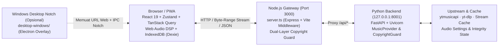

<div align="center">


# SoundClear

**Modern High-Fidelity Web Music Player, Web Audio DSP Engine & Synced Karaoke Experience**

[](https://react.dev/)
[](https://www.typescriptlang.org/)
[](https://vite.dev/)
[](https://tailwindcss.com/)
[](https://fastapi.tiangolo.com/)
[](https://web.dev/progressive-web-apps/)
[](https://github.com/Gojab/SoundClearr)

*Dibangun untuk kejernihan suara maksimal, antarmuka kaca gelap yang adaptif, pemrosesan DSP real-time di browser, serta dukungan offline & Windows Dynamic Notch.*

[Fitur Utama](#-fitur-utama) · [Arsitektur](#-arsitektur-sistem) · [Mulai Cepat](#-mulai-cepat) · [Variabel Lingkungan](#-variabel-lingkungan) · [API Backend](#-ringkasan-api-backend) · [Lisensi & Hak Cipta](#-hak-cipta--proteksi)

</div>

---

## ✨ Fitur Utama

### 🎚️ Mesin Audio Web DSP Fidelitas Tinggi
- **Equalizer 10-Band Real-Time**: Kurva respon frekuensi SVG interaktif berbasis `BiquadFilterNode`, lengkap dengan preset bawaan dan preset kustom tersimpan.
- **Bass Boost & Stereo Widener**: Penguatan frekuensi rendah dan perluasan panggung suara stereo dengan kontrol intensitas 0–100%.
- **Normalisasi Kenyaringan & Dinamika**: Target LUFS (`Quiet`, `Normal`, `Loud`), dukungan `ReplayGain`, `Limiter` anti-kliping, kontrol keseimbangan L/R, dan mode *Mono Audio*.
- **Transisi Halus & Output Fleksibel**: *Equal-power crossfade* (`0–12` detik), *Gapless Playback*, *Direct Mode*, pemilihan perangkat output audio, *Spectrum Analyzer* real-time, serta generator *Test Tone* diagnostik.

### 🎵 Katalog Musik, Streaming & Pustaka Offline
- **Integrasi Katalog Lengkap**: Beranda rekomendasi, Tangga Lagu Indonesia, Rak Mood & Genre, Pencarian + Saran Otomatis, Profil Artis, Album, Playlist, dan Podcast lengkap dengan pelacakan progres episode.
- **Streaming Adaptif & Fallback Pintar**: Endpoint streaming byte-range (`/api/stream/{video_id}`) dengan dukungan penyesuaian kualitas otomatis (*Data Saver* & kondisi jaringan) serta fallback mulus ke *YouTube IFrame Player*.
- **Impor Musik Lokal & Unduhan Offline**: Impor file pribadi (`MP3`, `FLAC`, `WAV`, `OGG`) lengkap dengan pembacaan metadata & sampul album (`music-metadata-browser`), tersimpan aman di **IndexedDB (`Dexie`)** dan **Cache Storage**.
- **Manajemen Koleksi & Rekap**: Playlist lokal & folder, lagu disukai, artis diikuti, histori pemutaran, serta halaman **Rekap** analitik pendengar (`4 minggu`, `6 bulan`, `sepanjang waktu`).

### 🪩 Pengalaman Visual, Lirik & Desktop Notch
- **Antarmuka Kaca Gelap Adaptif**: Ekstraksi warna ambient dari sampul lagu secara otomatis (`/api/artwork-color`) + kustomisasi latar (*Ambient*, *Preset*, *Warna Solid*, *Gradien*, atau *Gambar Kustom* dengan kontrol blur & *panel glass*).
- **Lirik Tersinkron & Mode Karaoke**: Tampilan lirik tersinkronisasi per baris secara real-time di panel kanan maupun layar penuh (`FullscreenKaraokeModal`).
- **Windows Dynamic Notch Mini Player**: Pil mini player di bagian atas layar dengan lirik live; tersedia pula pembungkus desktop **khusus Windows** (`desktop-windows/`) berbasis Electron (*frameless*, transparan, *click-through*, dan pemilihan monitor).
- **PWA & Responsif**: Mendukung instalasi *Progressive Web App* (`vite-plugin-pwa`) dengan shell khusus perangkat seluler (`MobileShell`).

### 🛡️ Backend Copyright Guard (`zhafx.corp`)
- Aturan kepemilikan dan atribusi `© 2026 zhafx.corp` dikunci di backend (`backend/copyright_guard.py`) dengan verifikasi integritas ganda pada **FastAPI** dan **Node.js (`server.ts`)**.
- Dilengkapi verifikasi kata sandi berbasis **PBKDF2-HMAC-SHA256** tersalt (*constant-time comparison*), *rate limiting* anti *brute-force*, dan penguncian API otomatis (`HTTP 451`) apabila atribusi hak cipta dihapus atau dimodifikasi tanpa otorisasi.

---

## 🏗️ Arsitektur Sistem



---

## 📁 Struktur Proyek

```text
SoundClearr/
├── server.ts                  # Server terpadu Express + Vite middleware + auto-bootstrap Python venv
├── package.json               # Skrip & dependensi Node.js / Frontend
├── vite.config.ts             # Konfigurasi Vite + Tailwind CSS v4 + VitePWA
├── tsconfig.json              # Konfigurasi TypeScript
├── src/                       # Entry point Vite (/src/main.tsx)
├── frontend/
│   └── src/
│       ├── api/               # Klien HTTP (/api/*) + unit test
│       ├── audio/             # Mesin Web Audio API DSP (EQ, Bass, Widener, LUFS, Crossfade)
│       ├── components/        # UI PlayerBar, Sidebar, RightPanel, Footer, Notch, Fullscreen
│       ├── db/                # Skema IndexedDB (Dexie) untuk pustaka & file lokal
│       ├── pages/             # Beranda, Pencarian, Moods, Detail, Pustaka, Rekap, Pengaturan
│       ├── store/             # State management Zustand (player, library, settings, navigation)
│       ├── types/             # Definisi tipe TypeScript
│       └── utils/             # Logika murni (audioMath, playerLogic, recapLogic, notch) + test
├── backend/
│   ├── main.py                # Aplikasi FastAPI, middleware hak cipta, dan seluruh endpoint /api/*
│   ├── music_provider.py      # Mesin katalog, lirik, ekstraksi warna sampul, & streaming audio
│   ├── copyright_guard.py     # Aturan hak cipta zhafx.corp, verifikasi PBKDF2, & cek integritas
│   ├── requirements.txt       # Dependensi Python (FastAPI, Uvicorn, ytmusicapi, yt-dlp, Pillow)
│   ├── test_music_provider.py # Unit test backend musik
│   └── test_copyright_guard.py# Unit test proteksi hak cipta & middleware
├── api/index.py               # Entry point serverless (Vercel)
└── desktop-windows/           # Aplikasi Electron Dynamic Notch khusus Windows 10/11
```

---

## 🚀 Mulai Cepat

### Prasyarat
- **Node.js 22+** & **npm**
- **Python 3.10+** (otomatis dibuatkan `backend/.venv` saat `server.ts` berjalan)
- **FFmpeg** (disarankan untuk pemrosesan/konversi aliran audio `yt-dlp`)

### 1. Instalasi & Jalankan Mode Pengembangan

```bash
# 1. Pasang dependensi Node.js
npm install

# 2. (Opsional) Salin konfigurasi environment
cp .env.example .env

# 3. Jalankan server pengembangan (Port 3000)
#    Otomatis menyiapkan backend/.venv, menjalankan FastAPI (8001), dan menyajikan Vite SPA
npm run dev
```

Buka aplikasi di browser pada **`http://localhost:3000`**.

### 2. Build & Mode Produksi

```bash
# Build bundle produksi Vite ke dist/
npm run build

# Jalankan server produksi (Express menyajikan dist/ + proxy /api ke FastAPI)
npm start
```

### 3. Menjalankan Pengujian (Unit Tests)

```bash
# Pemeriksaan tipe TypeScript
npm run lint

# Unit test logika frontend (54 test cases)
npx tsx --test \
  frontend/src/api/client.test.ts \
  frontend/src/utils/audioMath.test.ts \
  frontend/src/utils/backgroundTheme.test.ts \
  frontend/src/utils/notchPlayer.test.ts \
  frontend/src/utils/playerLogic.test.ts \
  frontend/src/utils/recapLogic.test.ts \
  frontend/src/utils/streamPlaybackLogic.test.ts

# Unit test backend Python (17 test cases)
backend/.venv/bin/python -m unittest discover -s backend -p "test_*.py"
```

### 4. Windows Desktop Notch (Opsional, Khusus Windows 10/11)

```bash
cd desktop-windows
npm install
set SOUNDCLEAR_URL=http://localhost:3000
npm start

# Atau build installer Windows (.exe)
npm run build:win
```

---

## ⚙️ Variabel Lingkungan

Konfigurasi dapat disetel melalui berkas `.env` (lihat `.env.example`):

| Variabel | Deskripsi | Default |
| :--- | :--- | :--- |
| `APP_PORT` | Port server utama Express + Vite | `3000` |
| `PYTHON_PORT` | Port internal proses FastAPI Python | `8001` |
| `CACHE_TTL_SECONDS` | Durasi cache metadata katalog musik | Default provider |
| `DISABLE_HMR` | Nonaktifkan Vite HMR (`true` di lingkungan iframe/tertentu) | `false` |
| `SOUNDCLEAR_AUDIO_SETTINGS_FILE` | Lokasi berkas penyimpanan profil audio server | Lokal backend |
| `SOUNDCLEAR_DISABLE_WARMUP` | Set `1` untuk menonaktifkan *warmup* katalog saat startup | `0` |
| `SOUNDCLEAR_PURE_PYTHON_STREAM` | Gunakan mode streaming murni Python | `0` |
| `SOUNDCLEAR_STREAM_CACHE_DIR` | Direktori cache sementara aliran audio | `/tmp/soundclear_stream_cache` |
| `YTMUSIC_COOKIES` | String cookie sesi YouTube Music (opsional) | — |
| `YTMUSIC_COOKIES_FILE` | Path ke berkas cookie YouTube Music (opsional) | — |

---

## ⌨️ Pintasan Keyboard

| Tombol | Aksi |
| :--- | :--- |
| `Spasi` | Putar atau jeda lagu aktif |
| `Panah Kanan` / `Panah Kiri` | Maju atau mundur 5 detik |
| `Shift + Panah Kanan` / `Kiri` | Lagu berikutnya / sebelumnya |
| `M` | Bisukan atau nyalakan kembali suara |
| `L` | Buka tab lirik / mode karaoke layar penuh |
| `S` | Aktifkan atau matikan *Shuffle* |
| `R` | Ubah mode ulang (`Mati` / `Semua` / `Satu Lagu`) |
| `?` | Buka halaman daftar pintasan keyboard |
| `Esc` | Tutup dialog, menu konteks, atau tampilan layar penuh |

---

## 🔌 Ringkasan API Backend

Seluruh endpoint berada di bawah prefix `/api` dan otomatis diproksikan oleh `server.ts` ke FastAPI:

| Kategori | Endpoint | Keterangan |
| :--- | :--- | :--- |
| **Kesehatan** | `GET /api/health` | Status server, provider, & integritas hak cipta |
| **Katalog** | `GET /api/home`, `/api/charts`, `/api/moods`, `/api/moods/{params}` | Beranda, tangga lagu, mood & genre |
| **Pencarian** | `GET /api/search`, `GET /api/suggest` | Pencarian multi-filter & saran kueri |
| **Detail** | `GET /api/artist/{id}`, `/api/album/{id}`, `/api/playlist/{id}`, `/api/podcast/{id}`, `/api/episode/{id}` | Metadata lengkap & daftar trek/episode |
| **Pemutaran** | `GET /api/watch/{video_id}`, `/api/play/resolve`, `/api/stream/{video_id}/meta`, `GET/HEAD /api/stream/{video_id}` | Antrean radio, resolusi ID, & streaming byte-range |
| **Lirik & Visual** | `GET /api/lyrics`, `/api/song/{id}/credits`, `/api/song/{id}/related`, `/api/artwork-color` | Lirik tersinkron, kredit lagu, & warna dominan sampul |
| **Pengaturan** | `GET/PUT /api/account/audio-settings`, `POST /api/account/audio-settings/reset` | Sinkronisasi profil DSP |
| **Hak Cipta** | `GET /api/copyright`, `POST /api/copyright/verify`, `PUT /api/copyright`, `DELETE /api/copyright` | Aturan hak cipta & otorisasi pengelola `zhafx.corp` |

---

## ©️ Hak Cipta & Proteksi

> **© 2026 zhafx.corp — Seluruh Hak Cipta Dilindungi.**

Aplikasi **SoundClear** beserta arsitektur antarmuka, konfigurasi DSP, dan kode sumbernya dikelola oleh **zhafx.corp**. Proyek ini dilengkapi **Copyright Guard** pada sisi backend yang memvalidasi integritas atribusi dan melindungi aturan hak cipta dengan otorisasi kata sandi pengelola. Penghapusan atau pengubahan atribusi resmi `zhafx.corp` tanpa otorisasi tidak diperkenankan dan akan memicu penguncian proteksi API secara otomatis.

<div align="center">

Dibangun dengan penuh presisi oleh **zhafx.corp** · **SoundClear**

</div>
